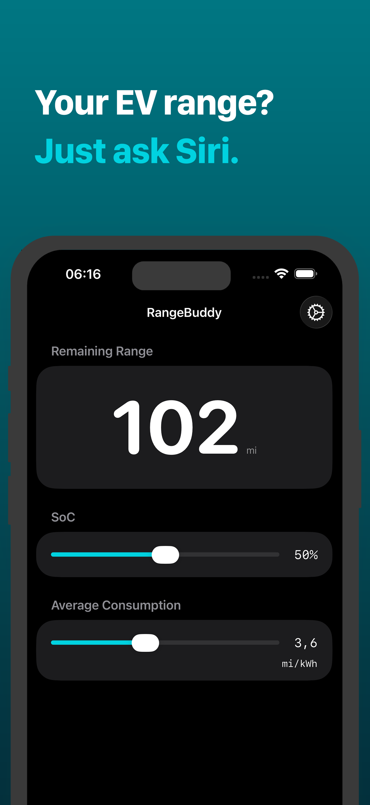
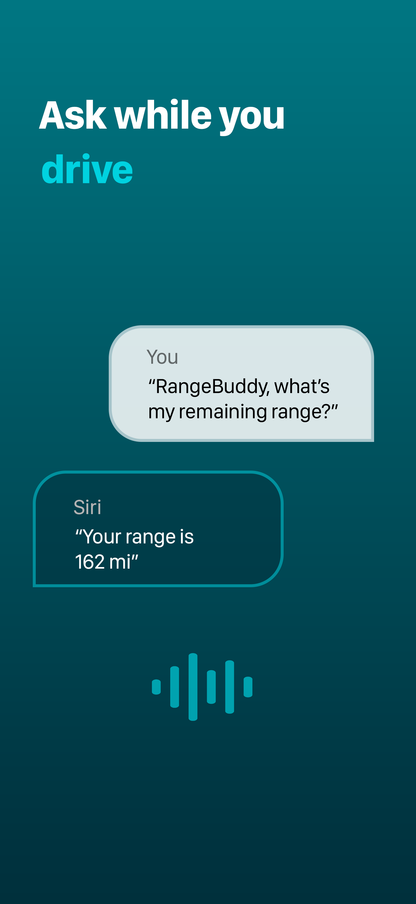
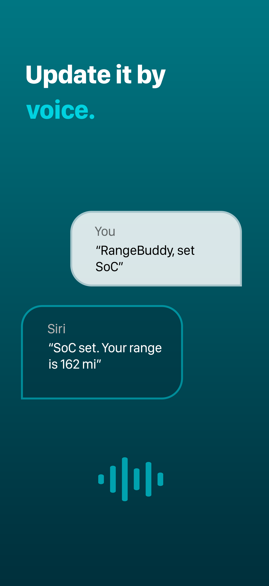
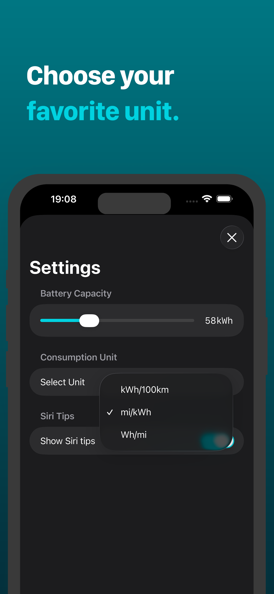

# RangeBuddy

*Tired of your EV guessing your range wrong?*  
*Let RangeBuddy work it out from your real consumption - and just ask Siri while you drive.*

RangeBuddy estimates how far your electric car can still go. Enter your **state of charge**, **average consumption**, and **battery capacity** - it does the math and shows your remaining range in kilometers or miles.

### Features
+ Siri / hands-free (control it entirely by voice while driving)
+ Live range that updates as you adjust the inputs
+ Miles & kilometers + multiple consumption units (kWh/100km, mi/kWh, Wh/mi)
+ Localized: English & German

### Using Siri
+ "Hey Siri, RangeBuddy set SoC"
+ "Hey Siri, RangeBuddy set consumption"
+ "Hey Siri, RangeBuddy set SoC and consumption"
+ "Hey Siri, RangeBuddy get range"

### Please note
+ RangeBuddy can't access your car's data (like the current charge). You enter all values yourself.  
+ Siri only accepts whole numbers for now (iOS 26).
+ Siri reserves words like 'battery' for your iPhone's own battery - say 'SoC' or 'charge percentage' instead.

### Build & Run
1. Clone the repo
2. Open `RangeBuddy.xcodeproj`
3. Build & run the `RangeBuddy` scheme on an iOS 26 simulator or device

*Siri commands work best on a real device.*

### License
RangeBuddy is released under the MIT License. See [LICENSE](LICENSE) for details.

### Get RangeBuddy
